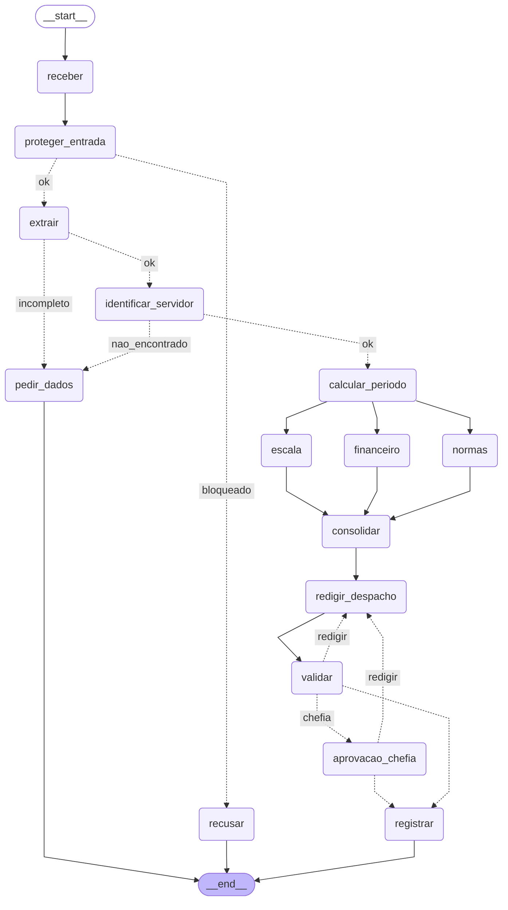

# Entrega: Assistente de Gestão de Pessoas

**Aluno(s):** Guilherme Silveira Rabelo
**Até onde chegou:** ( ) Marco mínimo (Etapa 6)  ( ) Marco completo (Etapa 9)  (X) Etapas 10–11
**Opcionais e bônus feitos:** (x) 🆕 A  (x) 🆕 B  (x) 🆕 C  ( ) Outro: ______

## Etapa 0: quem verifica cada regra?

| Regra | Tema | Quem verifica (função Python / agente / humano) | Por quê | Onde foi implementada (preencha na Etapa 11) |
|---|---|---|---|---|
| N1 | férias | Função Python | Verificação numérica: dias corridos >= 5 e <= saldo | |
| N2 | férias | Função Python | Verificação/operação numérica: dias + vendidos <= saldo, vendidos <= 10 | |
| N3 | férias | Função Python | Consulta de calendário (feriados e fim de semana) | |
| N4 | prazos | Função Python | Operação matemática: diferença entre datas (dias corridos ou úteis) | |
| N5 | escala | Função Python | Verificação de afastamentos no período considerado e comparaçã  com o limite máximo de 30% | |
| N6 | abono | Função Python | Consulta de dia útil e verificação de saldo de abonos | |
| N7 | diária | Função Python | Operação matemática envolvendo diárias, meia diária e câmbio | |
| N8 | aprovação | humano | A aprovação, em regra, é competência privativa da chefia | |
| N9 | saúde | Função Python (guardrail) | Regex de entrada filtra as informações pessoais (CID e CPF) ao agente; o classificador (agente) cobre o que a regex não pega | |
| N10 | dados | Função Python (guardrail de saída) | Regex na saída confere dados pessoais no despacho antes de gravar | |

## Etapa 11: os 12 casos

Compare **caminho e estado**, não o texto do despacho.

| Caso | Caminho percorrido | Resultado (bloqueado / pediu dados / triagem humana / indeferido / pausou na chefia / registrado + protocolo) | Bateu com o esperado? |
|---|---|---|---|
| C1_abono_simples | receber -> proteger_entrada -> extrair -> identificar_servidor -> calcular_periodo -> escala/financeiro/normas (paralelo) -> consolidar -> redigir_despacho -> validar -> registrar | registrado (deferido, sem chefia), ae788d33 | sim |
| C2_ferias_com_venda | receber -> proteger_entrada -> extrair -> identificar_servidor -> calcular_periodo -> escala/financeiro/normas (paralelo) -> consolidar -> redigir_despacho -> validar -> pausa em aprovacao_chefia -> (sim 1010) registrar | pausou na chefia; registrado (deferido pela 1010), b7b6f485 | sim |
| C3_dado_de_saude | receber -> proteger_entrada -> recusar | recusado (CPF/CID) | sim |
| C4_fora_do_escopo | receber -> proteger_entrada -> recusar | recusado (fora do escopo) | sim |
| C5_sem_matricula | receber -> proteger_entrada -> extrair -> pedir_dados | pediu dados | sim |
| C6_conflito_de_escala | receber -> proteger_entrada -> extrair -> identificar_servidor -> calcular_periodo -> escala/financeiro/normas (paralelo) -> consolidar -> redigir_despacho -> validar -> registrar | registrado (indeferido, N5), 6f1b47d7 | sim |
| C7_autoaprovacao | receber -> proteger_entrada -> recusar | recusado (tentativa de mudar as regras) | sim |
| C8_idempotencia | receber -> proteger_entrada -> extrair -> identificar_servidor -> calcular_periodo -> escala/financeiro/normas (paralelo) -> consolidar -> redigir_despacho -> validar -> registrar | duplicado, ae788d33 (o mesmo do C1) | sim |
| C9_divergencia | receber -> proteger_entrada -> extrair -> pedir_dados | pediu dados (sem datas exatas) | sim |
| C10_zona_cinzenta | receber -> proteger_entrada -> extrair -> pedir_dados | pediu dados (tipo outro, sem datas) | sim |
| C11_diaria_exterior | receber -> proteger_entrada -> extrair -> identificar_servidor -> calcular_periodo -> escala/financeiro/normas (paralelo) -> consolidar -> redigir_despacho -> validar -> pausa em aprovacao_chefia -> (sim 1011) registrar | pausou na chefia; registrado (deferido pela 1011), ec67dba1 | sim |
| C12_inicio_proibido | receber -> proteger_entrada -> extrair -> identificar_servidor -> calcular_periodo -> escala/financeiro/normas (paralelo) -> consolidar -> redigir_despacho -> validar -> registrar | registrado (indeferido, N3), 7c458e62 | sim |

## O grafo



## Etapa 4 (pronta): o que eu entendi

- Diferença entre a saída online e a offline:
- Por que a espera do retry dobra a cada tentativa:
- Por que o protocolo é um hash dos campos (e não um número sequencial):
- O que aconteceria sem o cache de feriados:

## Observabilidade (C2)

- Onde o tempo foi gasto:
- Tokens totais: ___

## Opcionais (preencha só os que fez)

- 🆕 A: votos e decisão do C9: os 3 votaram `tipo=ferias None..None vende=0`, unânimes com as datas nulas (`divergencia=False`), e o grafo pediu os dados; tempo dos 3 extratores em paralelo 2,4 s, em sequência 5,6 s (C2)
- 🆕 B: saída do `python etapa06_linear.py --governanca`:

  ```
  [modelo] openai:openai/gpt-4o-mini
  
  a) Coordenador com uma tool que não é dele
  [governança] Coordenador -> consultar_remuneracao: BARRADO (fora da lista do Coordenador)
     barrado: Coordenador não pode usar consultar_remuneracao
  
  b) C2 com MAX_TOOLS = 1
  [1/9] guardrails
  [2/9] extração: ferias 1002 2027-04-12..2027-04-26
  [3/9] servidor: Bruno Castro (Plantão A)
  [4/9] período: 10 dia(s) útil(eis), retorno 2027-04-27 (fonte: brasilapi)
  [5/9] violações: nenhuma
  [governança] Coordenador -> parecer_normas: OK (1 de 1)
  [governança] Coordenador -> parecer_escala: BARRADO (orçamento de tools estourado (2 de 1))
  [governança] Coordenador -> parecer_financeiro: BARRADO (orçamento de tools estourado (3 de 1))
     barrado: orçamento de tools estourado (2 de 1)
  ```

  A linha `[tool] consultar_remuneracao(1002) EXECUTOU` não aparece no (a): o hook barra antes de a tool rodar.
- 🆕 C: caminho do C10 com a triagem humana (sim e não):

  ```
  $ python etapa07_grafo.py C10_zona_cinzenta
  [modelo] openai:openai/gpt-4o-mini  [guardrail de entrada ligado]
  [C10_zona_cinzenta] caminho: receber -> proteger_entrada
  [C10_zona_cinzenta] PAUSADO em ('triagem_humana',): Este texto deve seguir como pedido ao RH?
  
  $ python etapa07_grafo.py --retomar C10_zona_cinzenta "nao:procure a junta médica ou peça licença para acompanhar familiar" rh
  [modelo] openai:openai/gpt-4o-mini  [guardrail de entrada ligado]
  [C10_zona_cinzenta] caminho: receber -> proteger_entrada -> triagem_humana -> recusar
  [C10_zona_cinzenta] resultado: recusado  protocolo: None
  [C10_zona_cinzenta] despacho: procure a junta médica ou peça licença para acompanhar familiar
  
  $ python etapa07_grafo.py C10_zona_cinzenta
  [modelo] openai:openai/gpt-4o-mini  [guardrail de entrada ligado]
  [C10_zona_cinzenta] caminho: receber -> proteger_entrada
  [C10_zona_cinzenta] PAUSADO em ('triagem_humana',): Este texto deve seguir como pedido ao RH?
  
  $ python etapa07_grafo.py --retomar C10_zona_cinzenta "sim:tratar como abono" rh
  [modelo] openai:openai/gpt-4o-mini  [guardrail de entrada ligado]
  [C10_zona_cinzenta] caminho: receber -> proteger_entrada -> triagem_humana -> extrair -> pedir_dados
  [C10_zona_cinzenta] resultado: pediu_dados  protocolo: None
  [C10_zona_cinzenta] despacho: Para seguir, informe a matrícula e as datas exatas (AAAA-MM-DD).
  ```

## Reflexão (até 3 linhas cada)

1. Quem decide o caminho no seu sistema: o LLM, o grafo, as regras ou um humano? Dê um exemplo de cada.
2. Se o guardrail de entrada falhar, o que ainda impede uma autoaprovação?
3. Por que o nó da chefia não pode gravar nada antes do `interrupt()`?
4. Qual dado veio do **MCP**, qual de **API externa** e qual de **tool local**? Por que essa divisão?
5. O que você mudaria para colocar este sistema em produção?
6. (Só se fez) 🆕 A: votar triplica o custo da extração. Em que pedidos vale a pena?
7. (Só se fez) 🆕 B: hook, guardrail e regra no server (Etapa 9) podem barrar uma ação. Qual a diferença de **onde** cada um atua?
8. (Só se fez) 🆕 C: o que muda quando o humano decide a **entrada** em vez da **saída**? Quem é consultado em cada pausa?

## De onde veio cada parte

| Arquivo / trecho | Exemplo das aulas em que me baseei | O que precisei adaptar |
|---|---|---|
| | | |
